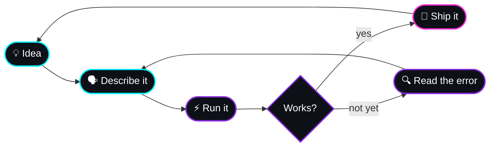

<!-- ============================================================
     declose · GitHub profile README (v3)
     Palette: cyan #00F0FF · purple #8A2BE2 · pink #FF2BD6 · bg #0D1117
     Only static badges + a few stable services are used, and every
     important fact is plain text so nothing important can "not load".
     ============================================================ -->

<div align="center">


<br />

<a href="https://github.com/declose?tab=repositories"></a>
<a href="https://github.com/declose?tab=stars"></a>
<a href="https://github.com/declose"></a>

</div>

---

## 🧭 About Me

```text
declose@arch ~ $ fastfetch --short

  user       declose
  os         Arch Linux (btw)
  editor     LazyVim
  langs      Python · C# · Bash
  workflow   vibe coding ✨
  hardware   Raspberry Pi
  hobbies    drawing · designing
  mission    build things that are actually useful
  status     Chilling...
```

I like computers, I like creating things, and I like figuring stuff out.
Arch was my first Linux distro and Python was my first language. Expect unfinished
projects, random ideas, and plenty of errors. That's how I learn.

---

## ✨ How I Vibe Code

I start with the *idea*, not the syntax: describe it, run it, break it, repeat.
The vibes get me moving, and understanding what I built makes it mine.



---

## 🚀 Projects

<table>
  <tr>
    <th align="left">Project</th>
    <th align="left">What it is</th>
    <th align="left">Built with</th>
  </tr>
  <tr>
    <td><a href="https://github.com/declose/Universal-File-Inspector"><b>Universal-File-Inspector</b></a></td>
    <td>A tool for inspecting files</td>
    <td></td>
  </tr>
  <tr>
    <td><a href="https://github.com/declose/PhilipsTV-RAT"><b>PhilipsTV-RAT</b></a></td>
    <td>Connect to and control your Philips TV straight from your PC</td>
    <td></td>
  </tr>
  <tr>
    <td><a href="https://github.com/declose/metadata-cleaner"><b>metadata-cleaner</b></a></td>
    <td>A simple, privacy-focused metadata cleaner</td>
    <td></td>
  </tr>
  <tr>
    <td><a href="https://github.com/declose/password-generator"><b>password-generator</b></a></td>
    <td>A password generator</td>
    <td></td>
  </tr>
</table>

---

## 🛠️ Toolbox


---

## 🎯 Direction

| 📚 Learn | 🧪 Experiment | 🎨 Create |
| :--- | :--- | :--- |
| Build a solid foundation | Try new ideas and tools | Turn ideas into projects that are mine |

---

<div align="center">

*Thanks for stopping by. If something I built helps you, leave a ⭐*


</div>
